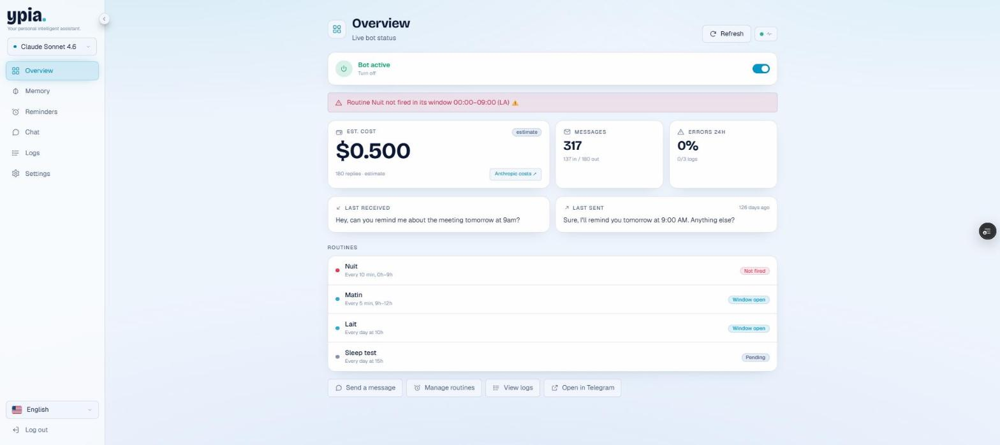
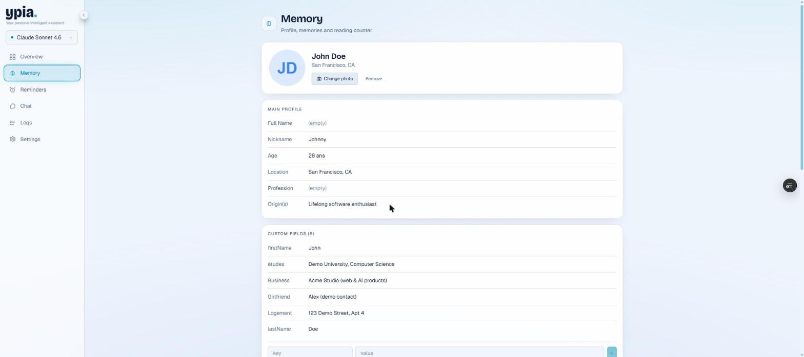
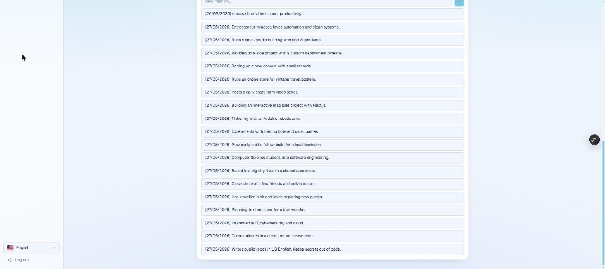
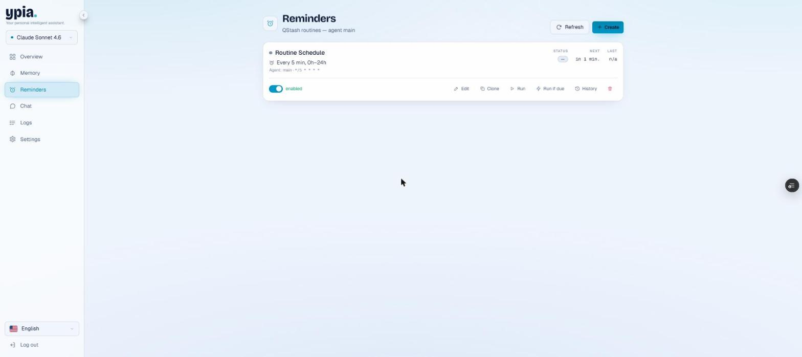
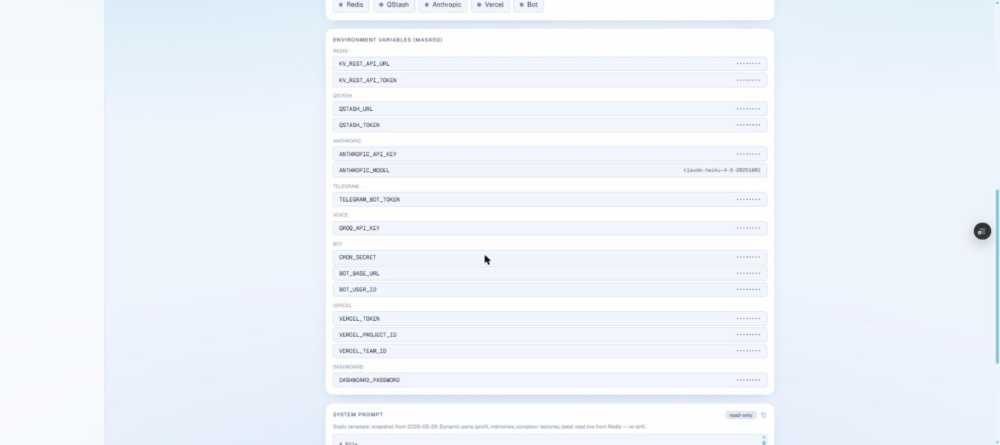
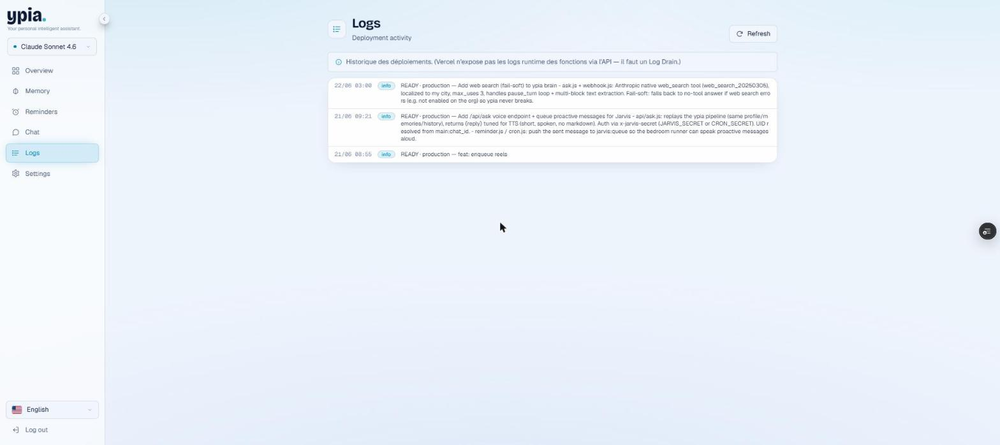
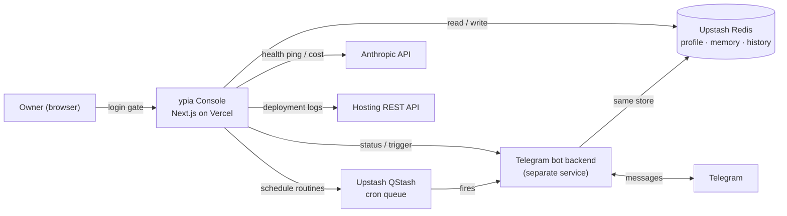

<div align="center">

# ypia — Personal Assistant Console

**A password-gated web console for a personal Telegram + Claude assistant.**
Monitor the bot, edit its long-term memory, schedule proactive routines, review conversations and check every service's health, from one dashboard.


</div>

> **Public showcase, not open source.** The code is published so you can read it. Reuse is not permitted. See [LICENSE](LICENSE).
>
> **About the screenshots:** every value shown below (profile, memory, conversations, environment variables) is **demo data**. No real personal data or secret is displayed.

---

## What it is

`ypia` is a personal assistant that lives in Telegram: you message it, it answers with Claude, and it remembers things about you across conversations. The bot itself runs as a separate serverless backend.

**This repository is the control console for that bot** — a single-account admin dashboard that lets its owner:

- see the bot's live status, cost and message volume at a glance
- read and edit the assistant's long-term **memory** (profile fields and remembered facts)
- create and run **scheduled routines** (proactive messages via a cron queue)
- browse the full **conversation history**
- verify that every connected service is reachable and inspect **deployment logs**
- manage connections, environment variables (masked) and the system prompt

---

## Screenshots

### Overview — live bot status
At-a-glance health: active toggle, estimated cost, message counts, error rate, last messages and the scheduled routines.



### Memory — profile and remembered facts
A structured profile plus a timeline of everything the assistant was asked to remember. Fully editable inline.




### Reminders — scheduled routines
Proactive routines backed by a cron queue, with run / clone / run-if-due controls and history.



### Settings — connections and environment
Service health checks and a masked view of the environment variables wired into the bot.



### Logs — deployment activity
Deployment history pulled from the hosting provider's API.



---

## Features

- **Single-account login gate** — email + password check enforced in middleware before any page or API route renders.
- **Live overview** — bot on/off switch, estimated Anthropic cost, message counts, 24h error rate and routine status, refreshed on demand.
- **Editable memory** — profile fields and custom fields plus a chronological list of remembered facts, read from and written back to the store.
- **Scheduled routines** — create, clone, enable/disable, run now or run-if-due; schedules are human-readable from their cron expressions.
- **Conversation history** — the full Telegram thread, rendered with Markdown.
- **Health checks** — one click pings Redis, the scheduler, Anthropic, the hosting API and the bot backend.
- **Masked settings** — every secret is shown masked; values never leave the server.
- **Light / dark theme** and **English / French** UI.

---

## Architecture

The console is a read-and-write window onto the same state the bot uses. It never talks to Telegram directly: it shares a key-value store with the bot backend and calls a few provider APIs.



- **Store-first**: the dashboard and the bot share one Redis store, so edits made here (memory, profile) are what the bot uses on its next reply.
- **No secrets in source**: every credential is read at runtime through a single server-only accessor (`lib/env.ts`); nothing is hardcoded. Copy `.env.example` to `.env.local` to run it.
- **Server-only data access**: provider tokens are used only in server routes and never shipped to the client.

---

## Tech stack

| Layer | Choice |
|---|---|
| Framework | Next.js 16 (App Router) + React 19 |
| Language | TypeScript 5 |
| Styling | Tailwind CSS 4, Radix UI primitives, `motion` |
| Data fetching | SWR |
| Validation | Zod |
| i18n | next-intl (EN / FR) |
| State store | Upstash Redis |
| Scheduling | Upstash QStash |
| AI | Anthropic Claude |
| Transcription | Groq |
| Hosting | Vercel |

---

## Project structure

```
app/
  (dashboard)/        # overview, memory, reminders, chat, logs, settings pages
  api/                # server routes backing each page
  login/              # login page
components/            # UI components
lib/                  # env access, store, cron, providers, system prompt, types
messages/             # i18n strings (en / fr)
proxy.ts              # auth gate (Next.js middleware)
docs/screenshots/     # images used in this README
```

---

## Local development

```bash
# 1. install
npm install

# 2. configure
cp .env.example .env.local      # then fill in your own values

# 3. run
npm run dev                     # http://localhost:3000
```

The app needs a Redis instance, a QStash token, Anthropic and (optionally) Groq keys, a Telegram bot, a hosting API token, and the login credentials (`ALLOWED_EMAIL`, `DASHBOARD_PASSWORD`). Every variable is documented in [`.env.example`](.env.example). The bot backend that answers Telegram messages is a separate service and is not included in this repository.

---

## License

**Public for demonstration, not open source.** All rights reserved — see [LICENSE](LICENSE). You may read the code; reuse requires written permission.
