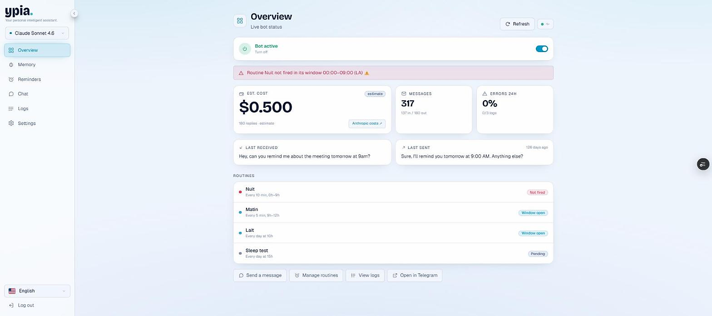
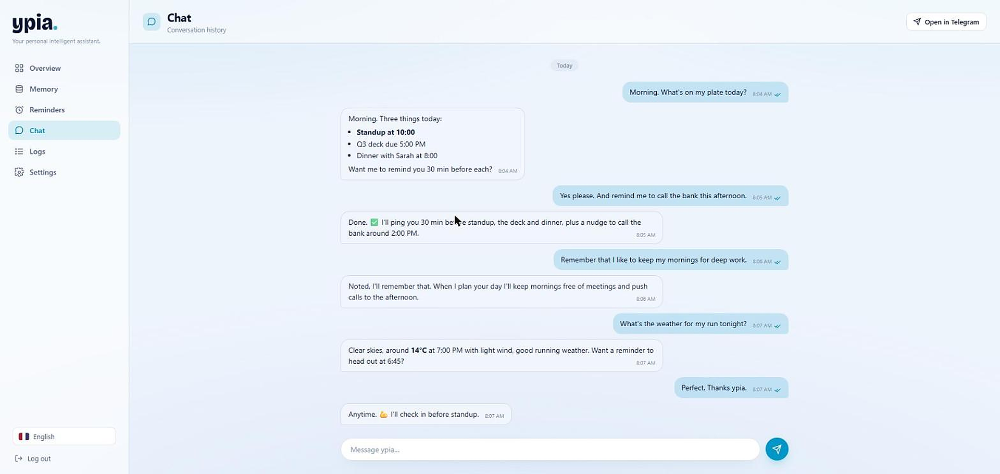
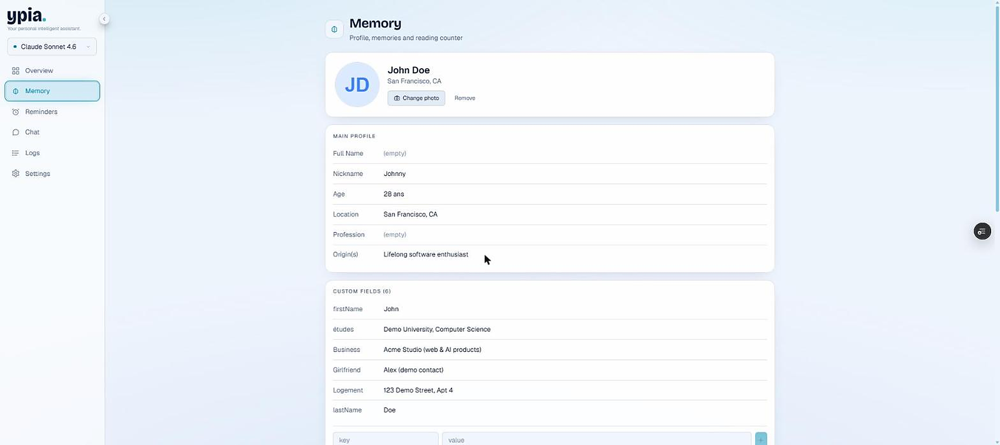
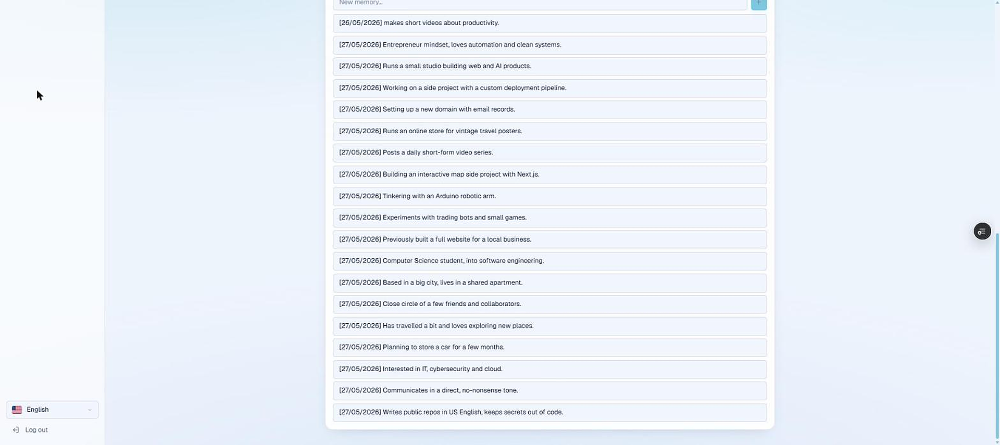
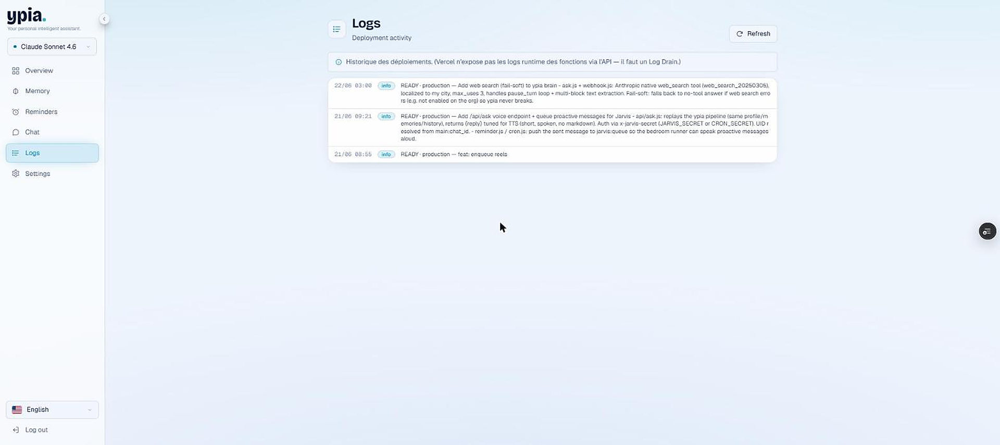
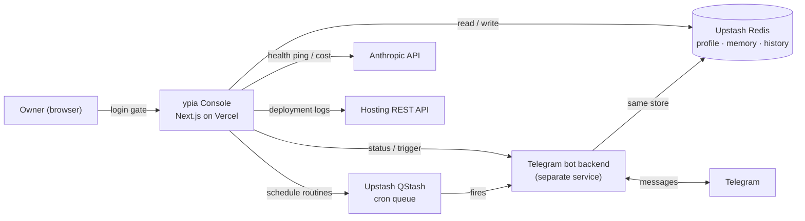

<div align="center">

# ypia. — Your Personal Intelligent Assistant


**A personal assistant that lives in your Telegram, remembers you, and runs your day — plus the private web console to steer it.**


</div>

> **Public showcase, not open source.** The code is published so you can read it. Reuse is not permitted. See [LICENSE](LICENSE).
>
> **About the screenshots:** every name, message and value shown below is **demo data**. No real personal data or secret is displayed.

---

## What ypia does for you

You text **ypia** on Telegram like you'd text a friend. It answers with Claude, but the difference is it **remembers you** — your projects, your people, your preferences — and it **acts**: it plans your day, sets reminders, and pings you before things happen. This repository is the private **web console** behind it: the cockpit where you watch the bot, edit its memory, and schedule its routines.

Here's what a normal day looks like for different people 👇

**🚀 The founder / freelancer**
> **You:** "What's on my plate today?"
> **ypia:** "Standup at 10:00, the Q3 deck due 5pm, dinner with Sarah at 8. Want reminders 30 min before each?"
> **You:** "Yes. And remember I keep mornings for deep work."
> **ypia:** "Noted. I'll keep your mornings meeting-free when I plan your days."

It remembers your clients, nudges you to send that invoice, and the console even shows you how much the bot is costing you in AI credits.

**🎓 The student**
> **You:** "Remind me the CS20A assignment is due Thursday 11pm."
> **ypia:** "Done. I'll ping you Wednesday evening and two hours before."

It keeps your class schedule, your deadlines, and answers quick questions — then proactively reminds you so nothing slips.

**👨‍👧 The busy parent**
> **You:** "Dinner at 7, don't let me forget to defrost the chicken."
> **ypia:** "Got it. I'll remind you at 5:30 to take it out."

Groceries, pickups, appointments — you offload the mental load and ypia keeps the thread.

**🏃 The everyday optimizer**
> **You:** "What's the weather for my run tonight?"
> **ypia:** "Clear, 14°C at 7pm, light wind — good conditions. Reminder to head out at 6:45?"

It checks the web when it needs to, remembers your habits, and gives you a straight answer with a nudge to actually do the thing.

The magic is **continuity**: it's the same assistant every time, with the same memory of who you are — not a fresh chatbot that forgets you after each message.

---

## The console (this repository)

The bot itself runs as a separate serverless backend. **This repo is the single-account admin dashboard** that lets its owner:

- see the bot's live status, cost and message volume at a glance
- read and edit the assistant's long-term **memory** (profile + remembered facts)
- create and run **scheduled routines** (the proactive pings)
- browse the full **conversation history**
- check that every connected service is healthy and review **deployment logs**

---

## Screenshots

### Overview — live bot status
At-a-glance health: active toggle, estimated cost, message counts, error rate, last messages and the scheduled routines.



### Chat — the conversation
The full Telegram thread, rendered with Markdown. This is ypia planning a day end-to-end: agenda, reminders, memory and a weather check.



### Memory — profile and remembered facts
A structured profile plus a timeline of everything the assistant was asked to remember. Editable inline.




### Reminders — scheduled routines
Proactive routines backed by a cron queue, with run / clone / run-if-due controls and history.


### Logs — deployment activity
Deployment history pulled from the hosting provider's API.



---

## Features

- **Single-account login gate** — email + password enforced in middleware before any page or API route renders.
- **Live overview** — bot on/off switch, estimated Anthropic cost, message counts, 24h error rate and routine status.
- **Editable memory** — profile fields, custom fields and a chronological list of remembered facts, read from and written back to the store.
- **Scheduled routines** — create, clone, enable/disable, run now or run-if-due; schedules are human-readable from their cron expressions.
- **Conversation history** — the full Telegram thread, rendered with Markdown.
- **Health checks** — one click pings Redis, the scheduler, Anthropic, the hosting API and the bot backend.
- **Light / dark theme** and **English / French** UI.

---

## Architecture

The console is a read-and-write window onto the same state the bot uses. It never talks to Telegram directly: it shares a key-value store with the bot backend and calls a few provider APIs.



- **Store-first**: the dashboard and the bot share one Redis store, so edits made here (memory, profile) are what the bot uses on its next reply.
- **No secrets in source**: every credential is read at runtime through a single server-only accessor (`lib/env.ts`); nothing is hardcoded. Copy `.env.example` to `.env.local` to run it.
- **Server-side sessions**: login issues a random, revocable session id stored in Redis; the middleware checks it on every request.

---

## Tech stack

| Layer | Choice |
|---|---|
| Framework | Next.js 16 (App Router) + React 19 |
| Language | TypeScript 5 |
| Styling | Tailwind CSS 4, Radix UI primitives, `motion` |
| Data fetching | SWR |
| Validation | Zod |
| i18n | next-intl (EN / FR) |
| State store | Upstash Redis |
| Scheduling | Upstash QStash |
| AI | Anthropic Claude |
| Transcription | Groq |
| Hosting | Vercel |

---

## Project structure

```
app/
  (dashboard)/        # overview, memory, reminders, chat, logs, settings pages
  api/                # server routes backing each page
  login/              # login page
components/            # UI components
lib/                  # env access, store, sessions, cron, providers, types
messages/             # i18n strings (en / fr)
proxy.ts              # auth gate (Next.js middleware)
docs/screenshots/     # images used in this README
```

---

## Local development

```bash
# 1. install
npm install

# 2. configure
cp .env.example .env.local      # then fill in your own values

# 3. run
npm run dev                     # http://localhost:3000
```

The app needs a Redis instance, a QStash token, Anthropic and (optionally) Groq keys, a Telegram bot, a hosting API token, and the login credentials (`ALLOWED_EMAIL`, `DASHBOARD_PASSWORD`). Every variable is documented in [`.env.example`](.env.example). The bot backend that answers Telegram messages is a separate service and is not included in this repository.

---

## License

**Public for demonstration, not open source.** All rights reserved — see [LICENSE](LICENSE). You may read the code; reuse requires written permission.
