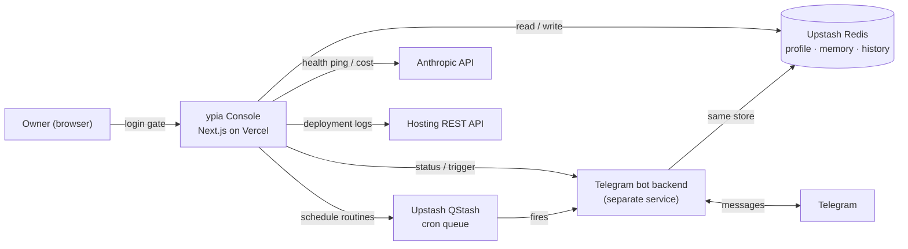

<div align="center">

# ypia. — Your Personal Intelligent Assistant


**A personal assistant that lives in your Telegram, remembers you, and runs your day — plus the private web console to steer it.**


</div>

> **Public showcase, not open source.** The code is published so you can read it. Reuse is not permitted. See [LICENSE](LICENSE).
>
> **About the screenshots:** every name, message and value shown below is **demo data**. No real personal data or secret is displayed.

---

## What ypia does for you

Alexa sets a timer. Google tells you the weather. Then they forget you existed. **ypia is the opposite.** It's a Claude-powered assistant with a memory of your whole life and the personality of a sharp, no-BS advisor: it remembers your projects and your people, connects the dots across weeks, and **pushes back** instead of just saying "OK." It doesn't flatter you, it tells you the trade-off. This repository is the private console behind it.

Here's the difference, depending on who you are 👇

**You are a founder / freelancer**
> **You:** "I think I'll launch a newsletter on the side."
> **ypia:** "You've got two half-finished projects I'm already tracking. A newsletter is a third start, not a finish. What does it get you that shipping the app this week doesn't?"

It won't cheer for every idea. It stress-tests them, remembers what you left unfinished, and names the opportunity cost out loud.

**You are a student**
> **You:** "I'll revise for the exam this weekend, promise."
> **ypia:** "That's the same line as the last two exams. It's Thursday, block 90 minutes tonight and I'll check in at 7. Deal?"

It knows your deadlines, calls out the pattern when you're avoiding, and turns a vague intention into a time you'll actually show up.

**You are juggling a hundred things**
> **You:** "Don't let me forget the storage unit before I move."
> **ypia:** "The one near the station you mentioned last week, for the car. You leave in 3 weeks. Want me to lock a deadline and nudge you Sunday?"

Tell it something once. It files it, links it to the rest of your life, and surfaces it at the exact right moment, not when you finally remember.

**You are building or shipping something**
> **You:** "How are things running?"
> **ypia:** "214 messages this week, $0.80 in AI credits, zero errors. Side note: you haven't logged a reading session in 6 days, that goal's slipping."

It watches the numbers for you and volunteers the uncomfortable one you didn't ask about.

The point was never commands. It's a **relationship with continuity**: one assistant, one memory of who you are, honest enough to actually move you.

---

## The console (this repository)

The bot itself runs as a separate serverless backend. **This repo is the single-account admin dashboard** that lets its owner:

- see the bot's live status, cost and message volume at a glance
- read and edit the assistant's long-term **memory** (profile + remembered facts)
- create and run **scheduled routines** (the proactive pings)
- browse the full **conversation history**
- check that every connected service is healthy and review **deployment logs**

---

## Screenshots

### Overview — live bot status
At-a-glance health: active toggle, estimated cost, message counts, error rate, last messages and the scheduled routines.


### Chat — the conversation
The full Telegram thread, rendered with Markdown. ypia planning a day end-to-end: agenda, reminders, memory and a weather check.


### Memory — profile and remembered facts
A structured profile plus a timeline of everything the assistant was asked to remember. Editable inline.


### Reminders — scheduled routines
Proactive routines backed by a cron queue, with run / clone / run-if-due controls and history.


### Logs — deployment activity
Deployment history pulled from the hosting provider's API.


---

## Features

- **Single-account login gate** — email + password enforced in middleware before any page or API route renders.
- **Live overview** — bot on/off switch, estimated Anthropic cost, message counts, 24h error rate and routine status.
- **Editable memory** — profile fields, custom fields and a chronological list of remembered facts, read from and written back to the store.
- **Scheduled routines** — create, clone, enable/disable, run now or run-if-due; schedules are human-readable from their cron expressions.
- **Conversation history** — the full Telegram thread, rendered with Markdown.
- **Health checks** — one click pings Redis, the scheduler, Anthropic, the hosting API and the bot backend.
- **Light / dark theme** and **English / French** UI.

---

## Architecture

The console is a read-and-write window onto the same state the bot uses. It never talks to Telegram directly: it shares a key-value store with the bot backend and calls a few provider APIs.



- **Store-first**: the dashboard and the bot share one Redis store, so edits made here (memory, profile) are what the bot uses on its next reply.
- **No secrets in source**: every credential is read at runtime through a single server-only accessor (`lib/env.ts`); nothing is hardcoded. Copy `.env.example` to `.env.local` to run it.
- **Server-side sessions**: login issues a random, revocable session id stored in Redis; the middleware checks it on every request.

---

## Tech stack

| Layer | Choice |
|---|---|
| Framework | Next.js 16 (App Router) + React 19 |
| Language | TypeScript 5 |
| Styling | Tailwind CSS 4, Radix UI primitives, `motion` |
| Data fetching | SWR |
| Validation | Zod |
| i18n | next-intl (EN / FR) |
| State store | Upstash Redis |
| Scheduling | Upstash QStash |
| AI | Anthropic Claude |
| Transcription | Groq |
| Hosting | Vercel |

---

## Project structure

```
app/
  (dashboard)/        # overview, memory, reminders, chat, logs, settings pages
  api/                # server routes backing each page
  login/              # login page
components/            # UI components
lib/                  # env access, store, sessions, cron, providers, types
messages/             # i18n strings (en / fr)
proxy.ts              # auth gate (Next.js middleware)
docs/screenshots/     # images used in this README
```

---

## Local development

```bash
# 1. install
npm install

# 2. configure
cp .env.example .env.local      # then fill in your own values

# 3. run
npm run dev                     # http://localhost:3000
```

The app needs a Redis instance, a QStash token, Anthropic and (optionally) Groq keys, a Telegram bot, a hosting API token, and the login credentials (`ALLOWED_EMAIL`, `DASHBOARD_PASSWORD`). Every variable is documented in [`.env.example`](.env.example). The bot backend that answers Telegram messages is a separate service and is not included in this repository.

---

## License

**Public for demonstration, not open source.** All rights reserved — see [LICENSE](LICENSE). You may read the code; reuse requires written permission.
